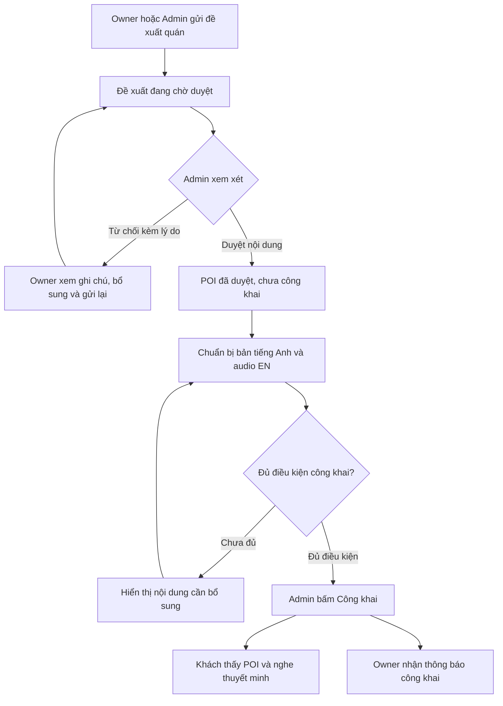

# P0 — Luồng hoạt động và chức năng quản lý POI

Cập nhật: **24/11/2026**.

POI là địa điểm/quán ăn được quản lý trong hệ thống. Luồng đã hoàn thiện gồm: gửi đề xuất, duyệt nội dung, chuẩn bị bản tiếng Anh và audio, công khai cho khách, theo dõi trạng thái và thông báo cho Owner.

## 1. Vai trò và chức năng

| Vai trò | Chức năng |
| --- | --- |
| Owner | Gửi quán mới hoặc đề xuất cập nhật; xem lịch sử, kết quả duyệt, lý do từ chối, địa điểm của mình và thông báo. |
| Admin | Duyệt hoặc từ chối đề xuất; quản lý nội dung, bản dịch, tác vụ audio; công khai hoặc ẩn POI theo quyền được cấp. |
| Khách tham quan | Xem POI đang công khai, chọn ngôn ngữ và nghe thuyết minh. |

Admin có quyền duyệt được duyệt cả đề xuất do chính mình gửi. Owner không được tự duyệt đề xuất của mình. Quyền duyệt và quyền công khai là hai quyền riêng.

## 2. Luồng từ gửi quán đến công khai

### Bước 1 — Gửi đề xuất

Owner đã được duyệt tài khoản hoặc Admin vào **Gửi quán mới**, nhập tên, mô tả, địa chỉ, tọa độ và thực đơn nếu có.

Sau khi gửi thành công, đề xuất xuất hiện trong **Trạng thái gửi duyệt** của người gửi và danh sách quán chờ duyệt của Admin. Với quán đã có, Owner có thể gửi đề xuất cập nhật để Admin xem xét.

### Bước 2 — Admin kiểm tra và duyệt

Admin mở **Duyệt chủ quán**, xem thông tin từng đề xuất.

- Đề xuất hợp lệ: Admin bấm **Duyệt quán**.
- Đề xuất thiếu hoặc sai dữ liệu: hệ thống hiển thị lý do ngay tại dòng quán, chẳng hạn thiếu vĩ độ/kinh độ; nút Duyệt bị khóa.
- Cần yêu cầu chỉnh sửa: Admin nhập lý do rồi bấm **Từ chối**. Owner xem ghi chú, bổ sung thông tin và gửi lại.

Admin có quyền duyệt có thể dùng chính tài khoản đã gửi đề xuất để duyệt, không cần đổi sang Admin khác.

Sau khi duyệt, đề xuất chuyển thành **Đã được duyệt** và rời danh sách chờ. POI xuất hiện trong danh sách quản lý và địa điểm của Owner, ở trạng thái **chưa công khai**.

### Bước 3 — Chuẩn bị tiếng Anh và audio

Tại danh sách quản lý POI, Admin bấm **Chuẩn bị English + Audio** để mở đúng địa điểm và bản tiếng Anh.

Admin nhập hoặc cập nhật tên, mô tả tiếng Anh rồi lưu. Hệ thống xếp tác vụ tạo audio cho nội dung đã lưu. Admin theo dõi tiến trình tại **Tác vụ âm thanh**.

### Bước 4 — Kiểm tra điều kiện công khai

Khi audio hoàn tất, Admin trở lại danh sách POI và bấm **Kiểm tra lại**.

Một POI đủ điều kiện công khai khi:

- Không ở trạng thái đã xóa/lưu trữ hoặc bị từ chối.
- Có kết quả duyệt nội dung hợp lệ nếu là POI của Owner.
- Có bản tiếng Anh với tên và mô tả đầy đủ, ở trạng thái sẵn sàng, không phải nội dung thay thế từ ngôn ngữ khác.
- Audio tiếng Anh đã sẵn sàng và có đường dẫn.

Nếu chưa đủ, hệ thống hiển thị lý do cần bổ sung và khóa nút **Công khai**. Không bắt buộc mọi ngôn ngữ đều có audio.

### Bước 5 — Công khai

Admin có quyền công khai bấm **Công khai**. Hệ thống kiểm tra lại các điều kiện trước khi thực hiện.

Khi thành công, khách có thể tìm thấy POI trên trang Khám phá/bản đồ, xem nội dung và nghe thuyết minh. Owner nhận thông báo POI đã công khai.

**Được duyệt hoặc tạo xong audio chưa đồng nghĩa đã công khai. Admin cần thực hiện bước Công khai.**

## 3. Quản lý trạng thái công khai

| Chức năng | Hoạt động |
| --- | --- |
| Xem trạng thái | Hiển thị POI đang công khai hay chưa, mức sẵn sàng của bản English và audio EN. |
| Chuẩn bị English + Audio | Mở phần bản dịch của đúng POI để bổ sung nội dung và tạo audio. |
| Kiểm tra lại | Làm mới trạng thái sau khi bản dịch hoặc audio thay đổi. |
| Công khai | Cho phép khách xem POI khi đã đủ điều kiện. |
| Ẩn khỏi công khai | Đưa POI về chưa công khai; Owner nhận thông báo và khách không còn thấy POI sau khi tải lại/đồng bộ. |
| Công khai lại | Admin kiểm tra điều kiện và công khai lại POI đã ẩn khi phù hợp. |

Duyệt cập nhật POI đang công khai sẽ đưa POI về chưa công khai để kiểm tra lại. Khi tên/mô tả nguồn thay đổi, bản dịch và audio cũ cần được kiểm tra hoặc tạo lại. Khi lưu lại bản English, audio cũ được thay bằng tác vụ tạo audio mới và POI đang công khai được ẩn để chờ kiểm tra.

Ẩn POI vẫn thực hiện được khi audio chưa sẵn sàng. POI đã xóa không được khôi phục bằng nút Công khai. Thiết bị đang hoàn toàn offline có thể còn dữ liệu đã tải cho đến khi đồng bộ lại.

## 4. Theo dõi lịch sử và thông báo của Owner

### Lịch sử gửi duyệt

Trang **Trạng thái gửi duyệt** hiển thị các đề xuất của tài khoản hiện tại, gồm cả Owner đã được duyệt tài khoản và Admin sử dụng cổng Owner.

| Trạng thái | Ý nghĩa |
| --- | --- |
| Đang chờ duyệt | Đã gửi đề xuất, đang chờ Admin xử lý. |
| Đã được duyệt | Nội dung đã được chấp nhận; xem trạng thái công khai tại địa điểm của mình. |
| Cần chỉnh sửa | Đề xuất bị từ chối; xem ghi chú để bổ sung và gửi lại. |

Lịch sử được cập nhật sau khi gửi thành công, khi vào trang lịch sử và khi quay lại tab. Người dùng có thể bấm **Tải lại lịch sử**. Hệ thống phân biệt rõ đang tải, tải lỗi và chưa có đề xuất; quán mới đã được duyệt vẫn được ghi đúng là **Quán mới**.

### Thông báo

Owner nhận thông báo trong ứng dụng khi:

- Đề xuất được duyệt, kèm hướng dẫn rằng POI còn chờ công khai.
- Đề xuất bị từ chối, kèm lý do cần chỉnh sửa.
- POI được công khai.
- POI bị ẩn khỏi công khai.

Owner xem thông báo để biết kết quả xử lý và trạng thái hiển thị với khách. Phần hướng dẫn QR cũng thể hiện rằng POI cần được công khai để khách sử dụng.

## 5. Quản lý tác vụ audio

Lưu bản dịch sẽ tạo yêu cầu sinh audio cho nội dung mới. Trang **Tác vụ âm thanh** hiển thị tên quán, ngôn ngữ, trạng thái, tiến độ và lỗi nếu có.

| Trạng thái | Chức năng có thể sử dụng |
| --- | --- |
| Chờ chạy | Hệ thống tự nhận việc; Admin có thể bấm Bắt đầu, Tạm dừng hoặc Hủy bỏ. |
| Đang tạo audio | Có thể Tạm dừng hoặc Hủy bỏ. |
| Đã tạm dừng | Có thể Tiếp tục hoặc Hủy bỏ. |
| Tạo thất bại/Đã hủy | Có thể Thử lại nếu đây vẫn là yêu cầu mới nhất của quán và ngôn ngữ đó. |
| Hoàn tất | Audio đã tạo xong; không còn nút Tạm dừng/Tiếp tục. |

Hệ thống cập nhật tiến trình tự động. Nếu tạo audio thất bại, giao diện hiển thị lý do để Admin xử lý hoặc thử lại. Khi backend khởi động lại, các tác vụ đang chờ được tiếp tục xử lý; tác vụ đã tạm dừng vẫn giữ trạng thái tạm dừng.

Kết quả của tác vụ cũ không được thay thế nội dung mới sau khi Admin đổi bản dịch hoặc hủy tác vụ. Khi xóa POI, các tác vụ audio chưa hoàn tất của POI được hủy.

**Tiếp tục là điều khiển quá trình tạo file, không phải nút nghe audio.** Tác vụ có thể tạo lại từ đầu hoặc dùng nội dung đã lưu trong bộ nhớ đệm; phần trăm thể hiện các mốc xử lý. Để nghe, khách dùng chức năng thuyết minh tại POI đang công khai.

## 6. Hiển thị và nghe theo ngôn ngữ

Khi khách chọn **VI Tiếng Việt**, hệ thống hiển thị bản Việt của POI. Nếu chưa có bản dịch VI riêng, hệ thống dùng tên và mô tả nguồn tiếng Việt, không tự chuyển sang tiếng Anh.

Khi chọn **EN English**, hệ thống hiển thị bản EN nếu đã có. Với ngôn ngữ khác chưa có bản dịch, hệ thống có thể dùng bản EN rồi đến VI làm nội dung thay thế và ghi nhận ngôn ngữ thực tế.

Ví dụ với quán **Ốc Tô**:

| Lựa chọn | Nội dung hiển thị và thuyết minh |
| --- | --- |
| VI | Tên Ốc Tô, mô tả tiếng Việt và thuyết minh tiếng Việt. |
| EN | Tên Snail Bowl theo bản dịch đã lưu, mô tả và thuyết minh tiếng Anh. |

Khi đổi ngôn ngữ, audio đang phát được dừng và nội dung được tải theo lựa chọn mới. Kết quả tải cũ đến muộn không ghi đè ngôn ngữ đang chọn. Nếu cần đọc văn bản thay cho file audio, giọng đọc theo ngôn ngữ thực tế của văn bản.

Bộ nhớ đệm VI bị lẫn nội dung EN được làm mới khi có kết nối. Nút đóng thanh phát cũng dừng âm thanh.

## 7. Hiển thị lỗi và hướng dẫn xử lý

| Tình huống | Hệ thống phản hồi |
| --- | --- |
| Đề xuất thiếu/sai tọa độ hoặc thông tin không hợp lệ | Hiện lý do tại dòng đề xuất, chưa cho duyệt. |
| Tài khoản thiếu quyền thao tác | Báo không có quyền thực hiện. |
| Từ chối nhưng chưa nhập ghi chú | Yêu cầu nhập lý do để Owner biết cần chỉnh sửa gì. |
| POI thiếu English hoặc audio EN | Hiện điều kiện còn thiếu, chưa cho công khai. |
| Không tạo được audio | Hiện trạng thái thất bại và lý do; cho thử lại khi phù hợp. |
| Mất kết nối hoặc lỗi máy chủ | Hiện thông báo lỗi, không báo thao tác thành công. |
| Duyệt thành công nhưng tải lại danh sách lỗi | Nói rõ đã duyệt thành công và cần tải lại danh sách. |
| Đề xuất đã được xử lý | Không duyệt thêm lần nữa hoặc tạo trùng POI. |

Trang **Duyệt chủ quán** có hai danh sách: đăng ký tài khoản Owner và đề xuất quán đang chờ. Quán do Admin tạo trực tiếp được quản lý tại danh sách POI, không tự sinh đề xuất Owner. Vì vậy, không thấy quán ở hàng chờ chưa có nghĩa là quán đã mất; cần xem lịch sử và danh sách quản lý POI.
